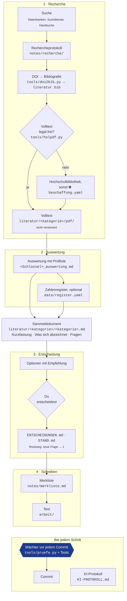

# evidence-to-thesis

**Von der Quelle über die Zahl zum Text.** Ein Arbeitsgerüst für
Abschlussarbeiten, in denen Zahlen aus der Literatur eine Rolle spielen:
Ordnerstruktur, Vorlagen, kleine Werkzeuge und Arbeitsregeln für einen
KI-Assistenten.

Entstanden bei einer Seminar- und einer Bachelorarbeit im Studiengang eHealth
der FH JOANNEUM. **Inoffiziell:** Das Kit ist keine Vorlage der Hochschule und
ersetzt deren Leitfäden nicht; bei Widersprüchen gilt der Leitfaden.

## Drei Grundsätze

1. **Jede Zahl hat eine Fundstelle:** Seite, Tabelle oder Abbildung, oder
   ausdrücklich „eigene Rechnung“, „Annahme“ oder „zu prüfen“.
2. **Jede Entscheidung hat eine Begründung:** in `ENTSCHEIDUNGEN.md`, mit den
   verworfenen Optionen.
3. **Jeder KI-Einsatz hat einen Protokolleintrag:** in `KI-PROTOKOLL.md`, mit
   dem, was du selbst am Original geprüft hast.

Ein Wächter prüft vor jedem Commit, ob das eingehalten ist, soweit sich das
mechanisch prüfen lässt.

## Ablauf



## Schnellstart

1. **Eigenes Repository anlegen:** oben rechts „Use this template“ →
   „Create a new repository“. **Empfehlung: privat.** Öffentliche Entwürfe kann
   jede Person lesen, und Plagiatssoftware findet sie später als Treffer zu
   deiner eigenen Arbeit.
2. **Klonen und einrichten:**
   ```bash
   pip install -r requirements.txt          # PyYAML
   git config core.hooksPath tools/hooks    # Wächter vor jedem Commit, einmalig
   ```
   Empfohlen ist dazu `pdftotext` (Paket `poppler-utils`): Damit prüft der
   Wächter, ob unter einem PDF-Namen wirklich die richtige Arbeit liegt.
3. **Umgebungsvariablen**, am besten in `~/.bashrc` oder `~/.zshrc`:
   ```bash
   export UNPAYWALL_EMAIL=deine@adresse                 # nur für holpdf.py, geht nur an Unpaywall
   export THESIS_KONTAKT=https://github.com/dein-name   # optional, Kontakt in der Kennung der Abfragen
   ```
4. **Erste Kategorie und erstes Rechercheprotokoll:**
   ```bash
   python3 tools/neu.py kategorie mein-thema
   python3 tools/neu.py protokoll mein-thema
   ```
5. **Treffer eintragen** (eine DOI je Tabellenzeile im Protokoll), dann:
   ```bash
   python3 tools/doi2bib.py --file notes/recherche/<protokoll>.md
   python3 tools/holpdf.py --kategorie mein-thema --file notes/recherche/<protokoll>.md
   python3 tools/status.py
   ```
   `doi2bib` holt die Bibliografie über Crossref, `holpdf` die frei
   verfügbaren Volltexte, `status` setzt den Stand hinter jede DOI. Was hinter
   einer Bezahlschranke liegt, holst du über die Hochschulbibliothek und legst
   es als `literatur/mein-thema/pdf/<Schlüssel>.pdf` ab.
6. **Auswerten:**
   ```bash
   python3 tools/neu.py auswertung mein-thema <Schlüssel>
   ```
   Prüfliste abarbeiten, Kernaussage mit Link ins Sammeldokument unter „Was
   sich abzeichnet“, neue Fragen in dessen Fragenteil.
7. **Entscheiden und festhalten:**
   - Weichenstellungen kommen nach `ENTSCHEIDUNGEN.md`.
   - Der Stand der Arbeit kommt nach `STAND.md`.
   - Punkte für den Text kommen nach `notes/merkliste.md`.
8. **Committen:** Der Wächter prüft und nennt, was fehlt. Bei jedem Lauf zählt
   er auf, welche Volltexte noch ausstehen.

## Was wo liegt

```
├── README.md            diese Anleitung
├── CLAUDE.md            Arbeitsregeln für den KI-Assistenten
├── ENTSCHEIDUNGEN.md    Entscheidungen mit Begründung
├── STAND.md             Stand, offene Entscheidungen, nächste Schritte
├── KI-PROTOKOLL.md      Nachweis des KI-Einsatzes
├── literatur.bib        Bibliografie (tools/doi2bib.py)
├── literatur/           je Kategorie: Sammeldokument, Auswertungen, pdf/ (nicht versioniert)
├── notes/
│   ├── merkliste.md     vorgemerkt für den Text, offene Fragen, Zurückgestelltes
│   └── recherche/       Rechercheprotokolle, beschaffung.yaml
├── data/register.yaml   Zahlenregister (optional)
├── arbeit/              der Text der Arbeit (LaTeX oder Word)
├── vorlagen/            Vorlagen für Auswertung, Sammeldokument, Protokoll, Entscheidung, KI-Eintrag
├── tools/               Werkzeuge und der Hook vor dem Commit
└── tests/               Tests der Werkzeuge
```

## Werkzeuge

| Skript | tut |
|---|---|
| `tools/neu.py` | legt Kategorie, Auswertung oder Protokoll aus den Vorlagen an |
| `tools/doi2bib.py` | DOI → BibTeX-Eintrag über Crossref, einheitlicher Zitierschlüssel |
| `tools/holpdf.py` | legale freie Volltexte über Unpaywall und Europe PMC |
| `tools/status.py` | setzt `·` `📄` `✅` `⛔` hinter jede DOI, aus dem Dateibestand abgeleitet |
| `tools/bestand.py` | gleicht Protokolle, Volltexte, Auswertungen und Beschaffung ab; prüft, ob im PDF die richtige Arbeit steckt |
| `tools/verweise.py` | findet tote Links in allen Markdown-Dateien |
| `tools/pruefe.py` | der Wächter: Prüflisten, Register, Bestand, Verweise |

Alle Werkzeuge brauchen nur Python 3 und PyYAML.

## Mit einem KI-Assistenten arbeiten

`CLAUDE.md` enthält die Arbeitsregeln. Claude Code liest die Datei beim Start
jeder Sitzung; anderen Assistenten gibst du sie als Anweisung mit. Die
wichtigsten Regeln:

- keine Zahl ohne Fundstelle;
- nur aus dem Volltext zitieren;
- bei Weichenstellungen erst Optionen, dann Ausführung;
- Erkenntnisse ins Sammeldokument;
- jeder Arbeitsgang ins KI-Protokoll.

Was an KI-Nutzung erlaubt ist und wie sie offenzulegen ist, regelt der
Leitfaden deiner Hochschule. Das KI-Protokoll hilft dir, ihn einzuhalten,
ersetzt ihn aber nicht.

## Das Kit aktualisieren

Ein Repository aus einer Vorlage hat eine eigene Historie und bekommt
Änderungen am Kit nicht automatisch. Die Ordner des Kits holst du so nach:

```bash
git remote add kit https://github.com/Veit-Kramer-Schoeggl/evidence-to-thesis.git   # einmalig
git fetch kit
git checkout kit/main -- tools tests vorlagen
git commit -m "Kit aktualisiert"
```

Deine Inhalte bleiben dabei unberührt: `literatur/`, `notes/`, `data/`,
`arbeit/` und die Dateien im Wurzelordner. Änderungen an `CLAUDE.md` oder am
README übernimmst du bei Bedarf von Hand.

## Mitmachen

Verbesserungen sind willkommen: Fork anlegen, Änderung in einem eigenen Branch,
dann einen Pull Request stellen. Für Fragen und Ideen gibt es die Issues. Den
Hauptzweig `main` pflegt nur der Maintainer.

## Grenzen

Der Wächter prüft, was sich mechanisch prüfen lässt. Er merkt nicht:
- einen Zahlendreher beim Abschreiben aus dem PDF;
- eine falsch verstandene Vergleichsgruppe;
- ob ein Sammeldokument inhaltlich noch stimmt.

Dafür sind die Prüfliste und dein eigener Blick da.

## Lizenz und Zitieren

MIT-Lizenz (`LICENSE`): frei nutzbar und veränderbar, auch in deiner Arbeit.
Wer das Kit selbst weitergibt, lässt den Lizenzhinweis dabei. Wenn du das Kit
in deiner Arbeit erwähnen willst, findest du die Angaben über „Cite this
repository“ (`CITATION.cff`).
