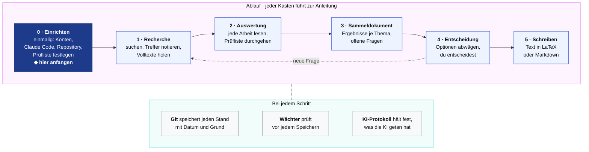

# evidence-to-thesis

**Von der Quelle über die Zahl zum Text.** Ein Gerüst für Abschlussarbeiten,
in denen Zahlen aus Studien vorkommen. Es besteht aus einer Ordnerstruktur,
Vorlagen, kleinen Prüfprogrammen und Arbeitsregeln für den KI-Assistenten
Claude Code.

Entstanden bei einer Seminar- und einer Bachelorarbeit im Studiengang eHealth
der FH JOANNEUM. **Inoffiziell:** Das Kit ist keine Vorlage der Hochschule und
ersetzt deren Leitfäden nicht. Wenn sich etwas widerspricht, gilt der
Leitfaden. Das Kit ist mit Unterstützung von Claude Code entstanden.

Dieses README ist die Übersicht über alles. Es folgt dem Ablauf unten; jede
Überschrift führt zur ausführlichen Anleitung. Fachwörter erklärt der
Abschnitt [Begriffe, kurz erklärt](#begriffe-kurz-erklärt).

## Drei Grundsätze

1. **Jede Zahl hat eine Fundstelle:** Seite, Tabelle oder Abbildung, oder
   ausdrücklich „eigene Rechnung“, „Annahme“ oder „zu prüfen“.
2. **Jede Entscheidung hat eine Begründung,** in
   [`ENTSCHEIDUNGEN.md`](ENTSCHEIDUNGEN.md), mit den Optionen, die du nicht
   gewählt hast.
3. **Jeder Schritt bleibt nachvollziehbar:** Git speichert jeden Stand, und
   das KI-Protokoll hält fest, was die KI getan und was du selbst geprüft hast.

Vor jedem Commit prüft ein kleines Programm, der **Wächter**, ob das
eingehalten ist, soweit sich das automatisch prüfen lässt.

## Der Ablauf



Ob sich die Kästen anklicken lassen, hängt davon ab, wo du das README liest;
GitHub lässt Klicks in Diagrammen nicht überall zu. Die Überschriften unten
führen in jedem Fall zu den Anleitungen.

## [0 · Einrichten](ablauf/0-einrichten.md)

Einmal am Anfang. **Du brauchst:**

- **Claude Code.** Das Kit ist für Claude Code gebaut und funktioniert nur
  damit. Claude Code braucht ein bezahltes Claude-Abo, mindestens Pro; mit dem
  kostenlosen Plan geht es nicht. Welcher Plan welche Modelle erlaubt, zeigt
  eine [Tabelle in der Anleitung](ablauf/0-einrichten.md#welcher-plan-welche-modelle-erlaubt).
- **Ein GitHub-Konto.** Der kostenlose Plan reicht.
- **Einen Rechner** mit Windows 10 (ab Version 1809) oder 11, macOS 13 oder
  neuer, oder Linux (Ubuntu ab 22.04, Debian ab 12).

**Die Schritte**, jeder mit Befehlen zum Kopieren für Windows, macOS und
Linux:

1. Konten bei GitHub und Claude anlegen.
2. Git, Python, das GitHub-Programm `gh` und Claude Code installieren.
3. Den Rechner mit GitHub verbinden.
4. Aus dem Kit dein eigenes, privates Repository anlegen und den Wächter
   einschalten.
5. Claude Code starten und prüfen lassen, ob alles bereit ist.
6. Wahlweise: Volltexte automatisch holen lassen.

### [Prüfliste festlegen](ablauf/pruefliste-festlegen.md)

Bevor du die erste Arbeit auswertest, legst du fest, worauf du bei jeder Arbeit
achtest. Die Prüfliste in [`vorlagen/auswertung.md`](vorlagen/auswertung.md)
ist ein Vorschlag für empirische Studien; streich, was für deine Arbeit nicht
passt, und ergänze, was fehlt. Der Wächter liest die Prüfliste aus der Vorlage
und verlangt ab dann deine Fassung. Die Anleitung zeigt mögliche Prüfpunkte je
nach Art der Studien.

## [1 · Recherche](ablauf/1-recherche.md)

Arbeiten finden, festhalten, wie du gesucht hast, und die Volltexte legal
beschaffen:

1. **Ein Thema anlegen**, also einen Ordner unter `literatur/`, bei Bedarf mit
   Unterordnern für Teilthemen. Dabei entsteht sein Sammeldokument.
2. **Ein Rechercheprotokoll anlegen** in `notes/recherche/`: womit, wann und
   wie du gesucht hast, die Suchanfrage wörtlich.
3. **Suchen und Treffer eintragen**, je Treffer eine Zeile mit der DOI vorne.
4. **Literaturangaben holen** in [`literatur.bib`](literatur.bib).
5. **Volltexte holen**: frei verfügbare automatisch, alle anderen über die
   Hochschulbibliothek. Was du nicht bekommst, kommt mit Grund in
   [`beschaffung.yaml`](notes/recherche/beschaffung.yaml).
6. **Den Stand nachziehen.** Hinter jeder DOI steht dann, wie weit die Arbeit
   ist: `·` fehlt noch, 📄 Volltext da, ✅ ausgewertet, ⛔ nicht zu bekommen.
   Dieselbe Übersicht steht als Tabelle „Stand“ im Sammeldokument, dort mit der
   DOI bei jeder Arbeit, die noch zu holen ist.

Volltexte kommen nie ins Repository; sie sind urheberrechtlich geschützt.

## [2 · Auswertung](ablauf/2-auswertung.md)

Jede Arbeit genau lesen, nach der Prüfliste, jede Zahl mit Fundstelle. Die
Auswertung entsteht aus der Vorlage
[`vorlagen/auswertung.md`](vorlagen/auswertung.md): Jeder Abschnitt bietet
Optionen und ein erfundenes Beispiel. Der Status „in Arbeit“ gilt, solange du
liest; „geprüft“, wenn alles abgehakt und die Auswertung im Sammeldokument
verlinkt ist.

Claude Code kann aus dem Volltext eine erste Fassung schreiben. Jede Zahl
prüfst du dann selbst im PDF. Wandert eine Zahl in eine eigene Rechnung oder
in den Text, kommt sie mit Fundstelle ins Zahlenregister
[`data/register.yaml`](data/register.yaml).

## [3 · Sammeldokument](ablauf/3-sammeldokument.md)

Je Thema eine Datei, die alles zusammenträgt:

| Abschnitt | was hineinkommt |
|---|---|
| Kurzfassung | der Stand des Themas in wenigen Absätzen |
| Stand | alle Arbeiten des Themas mit Zeichen und DOI; schreibt ein Programm selbst |
| Was sich abzeichnet | je geprüfter Auswertung die Kernaussage mit Link |
| Fragen | jede Frage mit Kennung (F1, F2 …), bis sie beantwortet oder entschieden ist |

Nichts verschwindet still: Eine erledigte Frage bekommt einen Befund und bleibt
stehen. Vorlage: [`vorlagen/sammeldokument.md`](vorlagen/sammeldokument.md).

## [4 · Entscheidung](ablauf/4-entscheidung.md)

An den Weichen deiner Arbeit zeigt Claude Code die Optionen mit Vor- und
Nachteilen und einer Empfehlung; entscheiden tust du. Die Entscheidung kommt
mit Begründung nach [`ENTSCHEIDUNGEN.md`](ENTSCHEIDUNGEN.md), nach der Vorlage
[`vorlagen/entscheidung.md`](vorlagen/entscheidung.md). Was offen ist und was
als Nächstes kommt, steht in [`STAND.md`](STAND.md). Ändert sich eine
Entscheidung, kommt ein datierter Nachtrag dazu; überschrieben wird nichts.

## [5 · Schreiben](ablauf/5-schreiben.md)

**LaTeX oder Markdown, nicht Word.** Bei Textdateien zeigt Git Zeile für
Zeile, was sich geändert hat. Eine Word-Datei ist dagegen gepackt: Git sieht
nur, dass sie sich geändert hat, nicht was. Deshalb schreibst du deine Arbeit
in `arbeit/` als Text:

- **LaTeX**, wenn deine Hochschule eine LaTeX-Vorlage hat oder du das Layout
  genau steuern willst. Daraus entsteht ein PDF.
- **Markdown**, wenn du einfach schreiben willst. Daraus macht das Programm
  pandoc eine Word-Datei oder ein PDF, auf Wunsch mit der Word-Vorlage deiner
  Hochschule.

**Word und PDF sind nur Ausgaben.** Du erzeugst sie aus dem Text in den Ordner
`arbeit/ausgabe/`, bearbeitest sie nicht von Hand und legst sie nicht ins
Repository. Was dir beim Lesen für den Text auffällt, sammelst du vorher in
der [Merkliste](notes/merkliste.md). Mehr in [`arbeit/README.md`](arbeit/README.md).

## [Bei jedem Schritt](ablauf/bei-jedem-schritt.md)

### Git ist Pflicht

Bei einer wissenschaftlichen Arbeit musst du zeigen können, wie deine
Ergebnisse entstanden sind. Deshalb ist Git in diesem Kit Pflicht, nicht Kür.

Git speichert jeden Stand deiner Arbeit mit Datum und einer kurzen Notiz, was
sich geändert hat und warum. Ein gespeicherter Stand heißt *Commit*. Mit
*Push* lädst du ihn zu GitHub hoch; dort liegt eine Sicherung. Davon hast du:

- Zu jeder Zahl siehst du, wann sie dazukam und wann sie sich geändert hat.
- Du kannst zu jedem früheren Stand zurück.
- Der Verlauf zeigt, dass du deine Arbeit Schritt für Schritt selbst
  erarbeitet hast, auch dort, wo eine KI geholfen hat.
- Geht dein Rechner kaputt, fehlt höchstens die Arbeit seit dem letzten Push.

Gute wissenschaftliche Praxis verlangt genau diese Nachvollziehbarkeit, etwa
der Kodex der Deutschen Forschungsgemeinschaft in Leitlinie 12,
„Dokumentation“; den Wortlaut zitiert die
[Anleitung](ablauf/bei-jedem-schritt.md#git-ist-pflicht). Claude Code
speichert und lädt hoch, wenn du es darum bittest.

### Der Wächter

Vor jedem Commit prüft der Wächter die Auswertungen, das Zahlenregister, den
Bestand an Protokollen, Volltexten und Auswertungen sowie alle Links. Findet
er einen Fehler, hält er den Commit auf und sagt, was fehlt. Bei Entwürfen
gibt er nur Hinweise.

Er merkt nicht, wenn du beim Abschreiben zwei Ziffern vertauschst, eine
Vergleichsgruppe falsch verstehst oder ein Sammeldokument inhaltlich nicht
mehr stimmt. Dafür sind die Prüfliste und dein eigener Blick da.

### Das KI-Protokoll

Nach jedem Arbeitsgang mit KI kommt ein Eintrag in
[`KI-PROTOKOLL.md`](KI-PROTOKOLL.md), nach der Vorlage
[`vorlagen/ki-protokoll-eintrag.md`](vorlagen/ki-protokoll-eintrag.md): der
Auftrag, was die KI getan hat, was du selbst am Original geprüft hast. Was an
KI-Nutzung erlaubt ist, regelt der Leitfaden deiner Hochschule. Die Regeln,
nach denen Claude Code hier arbeitet, stehen in [`CLAUDE.md`](CLAUDE.md).

## Begriffe, kurz erklärt

| Begriff | heißt hier |
|---|---|
| Repository | dein Projektordner samt Verlauf; die Kopie bei GitHub ist deine Sicherung |
| Commit | ein gespeicherter Stand mit kurzer Notiz, was sich geändert hat |
| Push | gespeicherte Stände zu GitHub hochladen |
| Terminal | ein Fenster, in das du Befehle eingibst; unter Windows die PowerShell |
| Claude Code | der KI-Assistent; er liest und schreibt die Dateien in deinem Repository |
| DOI | die dauerhafte Kennung eines Fachartikels, sie beginnt mit `10.` |
| Zitierschlüssel | der Kurzname einer Arbeit, z. B. `Mustermann2020`; so heißen auch ihr Volltext und ihre Auswertung |
| Markdown | Text mit wenigen Zeichen für die Form, z. B. `#` für eine Überschrift; alle Dokumente hier sind Markdown (`.md`) |
| LaTeX | ein Satzprogramm: Du schreibst Text mit Befehlen, daraus entsteht ein PDF |
| Wächter | ein kleines Prüfprogramm, das vor jedem Commit nachsieht, ob etwas fehlt |
| Auswertung | deine Notizen zu genau einer Studie, nach der Prüfliste |
| Sammeldokument | die Zusammenfassung aller Auswertungen eines Themas |

## Was wo liegt

```
├── README.md            diese Übersicht
├── ablauf/              die Anleitungen, von 0 · Einrichten bis 5 · Schreiben
├── BACKLOG.md           was aus der Bachelorarbeit noch ins Kit kommen könnte
├── CLAUDE.md            die Arbeitsregeln für Claude Code
├── ENTSCHEIDUNGEN.md    deine Entscheidungen mit Begründung
├── STAND.md             wo die Arbeit steht, was offen ist, was als Nächstes kommt
├── KI-PROTOKOLL.md      wofür du KI eingesetzt hast und was du selbst geprüft hast
├── literatur.bib        die Literaturangaben, aus den DOIs geholt
├── literatur/           ein Ordner je Thema, zum Beispiel:
│   └── schlaf/
│       ├── schlaf.md                     das Sammeldokument des Themas
│       ├── Mustermann2020_auswertung.md  eine Auswertung je Studie
│       ├── pdf/                          die Volltexte, nicht im Repository
│       └── studienabbruch/               ein Unterordner für ein Teilthema, gleich aufgebaut
│           ├── studienabbruch.md
│           └── pdf/
├── notes/
│   ├── merkliste.md     was in den Text soll, offene Fragen, Zurückgestelltes
│   └── recherche/       die Rechercheprotokolle und beschaffung.yaml
├── data/register.yaml   das Zahlenregister, wahlweise
├── arbeit/              der Text deiner Arbeit, in LaTeX oder Markdown
├── vorlagen/            Vorschläge mit Optionen und Beispielen für jede Art von Dokument
├── tools/               die kleinen Programme und der Wächter
└── tests/               Tests, die prüfen, ob die Programme richtig arbeiten
```

Mehr zum Ordner `literatur/` in [`literatur/README.md`](literatur/README.md).

## Die Programme

Du musst sie nicht selbst aufrufen: Claude Code tut das, wenn du es darum
bittest. Die Befehle stehen in den Anleitungen unter `ablauf/`.

| Programm | was es tut |
|---|---|
| [`tools/neu.py`](tools/neu.py) | legt ein Thema, eine Auswertung oder ein Rechercheprotokoll aus den Vorlagen an; mit `--knapp` ohne Optionen und Beispiele |
| [`tools/doi2bib.py`](tools/doi2bib.py) | holt zu jeder DOI die Literaturangabe und trägt sie in `literatur.bib` ein |
| [`tools/holpdf.py`](tools/holpdf.py) | lädt Volltexte, die legal frei verfügbar sind |
| [`tools/status.py`](tools/status.py) | zeigt bei jeder Arbeit, wie weit sie ist, in den Protokollen und in der Tabelle „Stand“ der Sammeldokumente |
| [`tools/bestand.py`](tools/bestand.py) | gleicht Protokolle, Volltexte und Auswertungen ab und prüft, ob in jeder PDF-Datei die richtige Arbeit steckt |
| [`tools/verweise.py`](tools/verweise.py) | findet Links, die ins Leere zeigen |
| [`tools/pruefe.py`](tools/pruefe.py) | der Wächter: ruft alle Prüfungen auf und meldet, was fehlt |

Die Programme brauchen nur Python ab Version 3.9 und das Paket PyYAML; beides
installierst du in [0 · Einrichten](ablauf/0-einrichten.md).

## Vorlagen anpassen

Die Vorlagen in `vorlagen/` sind Vorschläge. Übernimm, was dir hilft, und
streich den Rest. Fest ist nur, was die Programme lesen:

| Vorlage | fest |
|---|---|
| [Auswertung](vorlagen/auswertung.md) | Kopfzeile mit Zweck und Status, Zeile **Register:**, Prüfliste, Pflichtabschnitte |
| [Sammeldokument](vorlagen/sammeldokument.md) | Abschnitt „Was sich abzeichnet“; die beiden Kommentarzeilen der Tabelle „Stand“, wenn das Programm sie füllen soll |
| [Rechercheprotokoll](vorlagen/rechercheprotokoll.md) | Zeile **Ablage:**, eine Kennung am Anfang jeder Trefferzeile |

Wie du die Prüfliste änderst, steht in
[Prüfliste festlegen](ablauf/pruefliste-festlegen.md).

## Das Kit aktualisieren

Ein Repository aus einer Vorlage hat einen eigenen Verlauf und bekommt
Änderungen am Kit nicht von selbst. Programme und Tests holst du so nach, oder
du bittest Claude Code darum:

```bash
git remote add kit https://github.com/Veit-Kramer-Schoeggl/evidence-to-thesis.git   # einmalig
git fetch kit
git checkout kit/main -- tools tests
git diff HEAD kit/main -- vorlagen ablauf  # neue Vorschläge ansehen
git commit -m "Kit aktualisiert"
```

Deine Inhalte bleiben dabei unberührt: `literatur/`, `notes/`, `data/`,
`arbeit/` und die Dateien im Hauptordner. Auch deine Vorlagen bleiben, wie sie
sind. Was dir an neuen Vorschlägen gefällt, übernimmst du von Hand oder je
Datei mit `git checkout kit/main -- vorlagen/<datei>`.

## Mitmachen

Verbesserungen sind willkommen: Fork anlegen, die Änderung in einem eigenen
Branch machen, dann einen Pull Request stellen. Für Fragen und Ideen gibt es
die Issues. Was als Nächstes ins Kit kommen könnte, steht in
[`BACKLOG.md`](BACKLOG.md). Den Hauptzweig `main` pflegt nur der Maintainer.

## Lizenz und Zitieren

MIT-Lizenz ([`LICENSE`](LICENSE)): Du darfst das Kit frei nutzen und
verändern, auch für deine Arbeit. Wer das Kit selbst weitergibt, lässt den
Lizenzhinweis dabei. Willst du das Kit in deiner Arbeit erwähnen, findest du
die Angaben über „Cite this repository“ ([`CITATION.cff`](CITATION.cff)).
